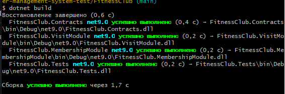
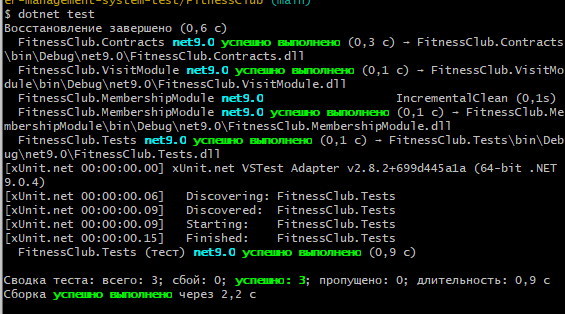
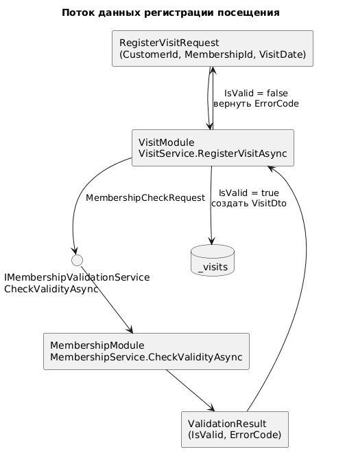

# Курсовое проектирование. Этап 3. Разработка и интеграция модулей проекта в режиме командной работы

**МДК:** 02.02 «Инструментальные средства разработки программного обеспечения»  
**Продолжительность:** 4 часа  
**Основной стек:** C# / .NET 9, Git  
**Форма:** этап курсового проектирования

## 1. Цель

Получить проверяемый результат по теме «Разработка и интеграция модулей проекта в режиме командной работы», связанный с собственным курсовым проектом «Разработка информационной системы фитнес-центра», и оформить его в репозитории так, чтобы решение можно было воспроизвести и проверить.

## 2. Предварительные условия

- тема курсового проекта согласована с преподавателем;
- создан репозиторий проекта;
- установлен .NET SDK 9 и Git;
- структура проекта соответствует его фактическим задачам;
- зафиксировано исходное состояние репозитория перед началом этапа (`git status`).

---

## 3. Выполнение требований этапа

## 3.1. У каждого модуля есть ясная ответственность

Решение `FitnessClub.sln` разделено на 4 отдельных проекта на платформе `.NET 9.0`:

- **`FitnessClub.Contracts`** — хранит модели данных (DTO) и интерфейс контракта `IMembershipValidationService`.
- **`FitnessClub.MembershipModule`** — отвечает за создание абонементов, расчет дат действия и проверку валидности абонемента (`MembershipService`).
- **`FitnessClub.VisitModule`** — отвечает за регистрацию посещений клиентов и хранение списка визитов (`VisitService`).
- **`FitnessClub.Tests`** — отвечает за модульное и интеграционное тестирование системы (`FitnessClubTests`).

---

## 3.2. Контракт зафиксирован до окончательного объединения

До объединения модулей в проекте `FitnessClub.Contracts` (`Contracts.cs`) был зафиксирован общий контракт взаимодействия и структуры DTO:

```csharp
namespace FitnessClub.Contracts;

public record CustomerDto(
    Guid Id,
    string FullName,
    string Phone,
    DateTime BirthDate
);

public record MembershipDto(
    Guid Id,
    Guid CustomerId,
    string Type,
    DateTime StartDate,
    DateTime EndDate,
    decimal Price,
    string Status
);

public record RegisterVisitRequest(
    Guid CustomerId,
    Guid MembershipId,
    DateTime VisitDate
);

public record MembershipCheckRequest(
    Guid MembershipId,
    DateTime VisitDate
);

public record ValidationResult(
    bool IsValid,
    string? ErrorCode = null
);

public record VisitDto(
    Guid Id,
    Guid CustomerId,
    Guid MembershipId,
    DateTime VisitDate,
    string Status
);

public interface IMembershipValidationService
{
    Task<ValidationResult> CheckValidityAsync(MembershipCheckRequest request);
}
```

---


## 3.3. Для интеграционной границы реализован успешный и минимум один отрицательный сценарий

Взаимодействие между `VisitService` и `MembershipService` выполняется через метод `CheckValidityAsync`. Реализованы:

- **Успешный сценарий:** абонемент найден, имеет статус `"Active"` и актуален на дату визита — возвращается `ValidationResult(true, null)`, визит сохраняется со статусом `"Registered"`.
- **Отрицательные сценарии:**
  - `MEMBERSHIP_NOT_FOUND` — абонемент не найден;
  - `MEMBERSHIP_BLOCKED` — абонемент заблокирован (`Status == "Blocked"`);
  - `MEMBERSHIP_EXPIRED` — дата визита выходит за границы `StartDate.Date` и `EndDate.Date`.

Код модуля `FitnessClub.MembershipModule` (`MembershipService.cs`):

```csharp
using FitnessClub.Contracts;
using Microsoft.Extensions.Logging;

namespace FitnessClub.MembershipModule;

public class MembershipService : IMembershipValidationService
{
    private readonly ILogger<MembershipService> _logger;
    private readonly Dictionary<Guid, MembershipDto> _memberships = new();

    public MembershipService(ILogger<MembershipService> logger)
    {
        _logger = logger;
    }

    public MembershipDto CreateMembership(Guid customerId, string type, DateTime startDate, int durationDays, decimal price, string status = "Active")
    {
        var membership = new MembershipDto(
            Guid.NewGuid(),
            customerId,
            type,
            startDate,
            startDate.AddDays(durationDays),
            price,
            status
        );

        _memberships[membership.Id] = membership;

        _logger.LogInformation(
            "Создан абонемент {MembershipId} для клиента {CustomerId}. Срок: {StartDate:yyyy-MM-dd} - {EndDate:yyyy-MM-dd}, Статус: {Status}",
            membership.Id, customerId, membership.StartDate, membership.EndDate, membership.Status);

        return membership;
    }

    public Task<ValidationResult> CheckValidityAsync(MembershipCheckRequest request)
    {
        _logger.LogInformation(
            "Проверка абонемента {MembershipId} на дату визита {VisitDate:O}",
            request.MembershipId, request.VisitDate);

        if (!_memberships.TryGetValue(request.MembershipId, out var membership))
        {
            _logger.LogWarning("Абонемент {MembershipId} не найден", request.MembershipId);
            return Task.FromResult(new ValidationResult(false, "MEMBERSHIP_NOT_FOUND"));
        }

        if (string.Equals(membership.Status, "Blocked", StringComparison.OrdinalIgnoreCase))
        {
            _logger.LogWarning("Абонемент {MembershipId} заблокирован", request.MembershipId);
            return Task.FromResult(new ValidationResult(false, "MEMBERSHIP_BLOCKED"));
        }

        if (request.VisitDate.Date < membership.StartDate.Date || request.VisitDate.Date > membership.EndDate.Date)
        {
            _logger.LogWarning(
                "Срок действия абонемента {MembershipId} истек (EndDate: {EndDate:yyyy-MM-dd}, VisitDate: {VisitDate:yyyy-MM-dd})",
                request.MembershipId, membership.EndDate, request.VisitDate);
            return Task.FromResult(new ValidationResult(false, "MEMBERSHIP_EXPIRED"));
        }

        _logger.LogInformation("Абонемент {MembershipId} успешно прошел проверку", request.MembershipId);
        return Task.FromResult(new ValidationResult(true, null));
    }
}
```

---

## 3.4. Добавлено журналирование с контекстом

В классах `MembershipService` и `VisitService` используется `ILogger<T>` с передачей контекста операции (`CustomerId`, `MembershipId`, `VisitDate`, `StartDate`, `EndDate`, `Status`, `ErrorCode`, `VisitId`).

Код модуля `FitnessClub.VisitModule` (`VisitService.cs`):

```csharp
using FitnessClub.Contracts;
using Microsoft.Extensions.Logging;

namespace FitnessClub.VisitModule;

public class VisitService
{
    private readonly IMembershipValidationService _membershipValidator;
    private readonly ILogger<VisitService> _logger;
    private readonly List<VisitDto> _visits = new();

    public VisitService(IMembershipValidationService membershipValidator, ILogger<VisitService> logger)
    {
        _membershipValidator = membershipValidator;
        _logger = logger;
    }

    public async Task<(bool Success, string? ErrorCode, VisitDto? Visit)> RegisterVisitAsync(RegisterVisitRequest request)
    {
        _logger.LogInformation(
            "Запрос на регистрацию визита: CustomerId={CustomerId}, MembershipId={MembershipId}, VisitDate={VisitDate:O}",
            request.CustomerId, request.MembershipId, request.VisitDate);

        var validation = await _membershipValidator.CheckValidityAsync(
            new MembershipCheckRequest(request.MembershipId, request.VisitDate));

        if (!validation.IsValid)
        {
            _logger.LogWarning(
                "Отказ в регистрации визита для клиента {CustomerId} по абонементу {MembershipId}. Код ошибки: {ErrorCode}",
                request.CustomerId, request.MembershipId, validation.ErrorCode);

            return (false, validation.ErrorCode, null);
        }

        var visit = new VisitDto(
            Guid.NewGuid(),
            request.CustomerId,
            request.MembershipId,
            request.VisitDate,
            "Registered"
        );

        _visits.Add(visit);

        _logger.LogInformation(
            "Визит {VisitId} успешно зарегистрирован для клиента {CustomerId}",
            visit.Id, request.CustomerId);

        return (true, null, visit);
    }

    public IReadOnlyList<VisitDto> GetVisits() => _visits.AsReadOnly();
}
```

---

## 3.5. Добавлен минимум один модульный и интеграционный тест

В проекте `FitnessClub.Tests` (`FitnessClubTests.cs`) реализованы модульный тест (`MembershipService_WhenMembershipExpired_ReturnsMembershipExpiredError`) и два интеграционных теста (`VisitIntegration_WhenMembershipIsActive_RegistersVisitSuccessfully` и `VisitIntegration_WhenMembershipIsBlocked_RejectsVisit`):

```csharp
using FitnessClub.Contracts;
using FitnessClub.MembershipModule;
using FitnessClub.VisitModule;
using Microsoft.Extensions.Logging.Abstractions;

namespace FitnessClub.Tests;

public class FitnessClubTests
{
    [Fact]
    public async Task MembershipService_WhenMembershipExpired_ReturnsMembershipExpiredError()
    {
        var service = new MembershipService(NullLogger<MembershipService>.Instance);
        var startDate = new DateTime(2026, 9, 1);
        var membership = service.CreateMembership(Guid.NewGuid(), "Месячный безлимит", startDate, 30, 3500m);

        var visitDate = new DateTime(2026, 10, 15); 
        var result = await service.CheckValidityAsync(new MembershipCheckRequest(membership.Id, visitDate));

        Assert.False(result.IsValid);
        Assert.Equal("MEMBERSHIP_EXPIRED", result.ErrorCode);
    }

    [Fact]
    public async Task VisitIntegration_WhenMembershipIsActive_RegistersVisitSuccessfully()
    {
        var membershipService = new MembershipService(NullLogger<MembershipService>.Instance);
        var visitService = new VisitService(membershipService, NullLogger<VisitService>.Instance);

        var customerId = Guid.NewGuid();
        var startDate = new DateTime(2026, 10, 1);
        var membership = membershipService.CreateMembership(customerId, "Месячный безлимит", startDate, 30, 3500m);

        var request = new RegisterVisitRequest(customerId, membership.Id, new DateTime(2026, 10, 15));
        var (success, errorCode, visit) = await visitService.RegisterVisitAsync(request);

        Assert.True(success);
        Assert.Null(errorCode);
        Assert.NotNull(visit);
        Assert.Single(visitService.GetVisits());
    }

    [Fact]
    public async Task VisitIntegration_WhenMembershipIsBlocked_RejectsVisit()
    {
        var membershipService = new MembershipService(NullLogger<MembershipService>.Instance);
        var visitService = new VisitService(membershipService, NullLogger<VisitService>.Instance);

        var customerId = Guid.NewGuid();
        var startDate = new DateTime(2026, 10, 1);
        var membership = membershipService.CreateMembership(customerId, "Годовой с бассейном", startDate, 365, 25000m, status: "Blocked");

        var request = new RegisterVisitRequest(customerId, membership.Id, new DateTime(2026, 10, 15));
        var (success, errorCode, visit) = await visitService.RegisterVisitAsync(request);

        Assert.False(success);
        Assert.Equal("MEMBERSHIP_BLOCKED", errorCode);
        Assert.Null(visit);
        Assert.Empty(visitService.GetVisits());
    }
}
```

---

## 3.6. После объединения выполняются `dotnet build` и `dotnet test`

После объединения модулей выполнена сборка решения и запуск всех тестов:

```bash
dotnet build
dotnet test
```

Результат dotnet build:



Результат dotnet test:



---

## 3.7. Схема потока данных



---

## 3.8. Найденные интеграционные проблемы и способ их устранения

1. **Конфликт в файле решения `FitnessClub.sln` при объединении веток.**
   - **Проблема:** в параллельных ветках `feature/membership-module` и `feature/visit-module` проекты добавлялись в один и тот же файл `FitnessClub.sln`.
   - **Способ устранения:** при слиянии в `feature/stage3-integration` ссылки на все проекты были объединены в `FitnessClub.sln` и проверены через `dotnet build`.
2. **Сравнение даты визита с учетом времени суток.**
   - **Проблема:** при сравнении `DateTime` со временем суток визит в последний день действия абонемента мог отклоняться.
   - **Способ устранения:** в `MembershipService.CheckValidityAsync` сравнение выполняется по календарным датам через свойство `.Date` (`request.VisitDate.Date < membership.StartDate.Date || request.VisitDate.Date > membership.EndDate.Date`).

---

## 4. Контрольные вопросы

1. Какой конкретный результат этапа можно независимо проверить?  
2. Какие артефакты были созданы или обновлены?
3. Какими командами или тестами подтвержден результат?  
4. Какие интеграционные риски уменьшены?
5. Какие изменения в будущем потребуют обновления артефактов этого этапа?  
6. Как по истории Git определить выполненные действия?  
7. Какие ошибки были найдены при самопроверке?
8. Что необходимо другому разработчику для повторения результата?

## 5. Вывод

Этап считается завершенным, когда результат существует не только в коде или словах автора, но и подтверждается репозиторием, документацией и проверками.
