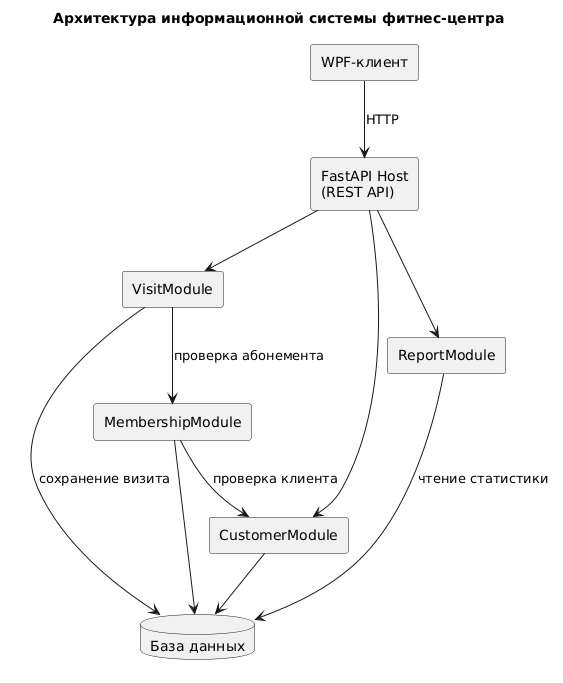

# 5. Архитектурная схема

Для проекта выбрана клиент-серверная архитектура с модульным бэкендом.

Центральным модулем бизнес-процесса рецепции является `VisitModule`.

При отметке посещения он:

1. получает запрос от WPF-клиента;
2. запрашивает у модуля абонементов актуальность контракта;
3. при успешной проверке создает запись о визите;
4. сохраняет данные в БД.