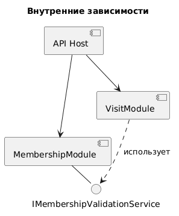

# 7. Внутренние зависимости

Внутренние зависимости на сервере определяют взаимодействие модулей.

Взаимодействие между модулями выполняется через публичные сервисные контракты.

---

# 8. Внешние зависимости

На этапе проектирования предполагается использование следующих внешних компонентов.

| Зависимость | Назначение |
|---|---|
| .NET 9 | Платформа выполнения WPF-клиента |
| WPF | Создание пользовательского интерфейса |
| Python | Платформа выполнения сервера |
| FastAPI | Разработка серверного REST API |
| SQLAlchemy | ORM для доступа к данным |
| PostgreSQL | Хранение реляционных данных |
| Git | Контроль версий |

Конкретные версии библиотек фиксируются в конфигурационных файлах проектов.

---